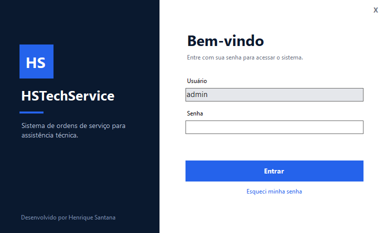
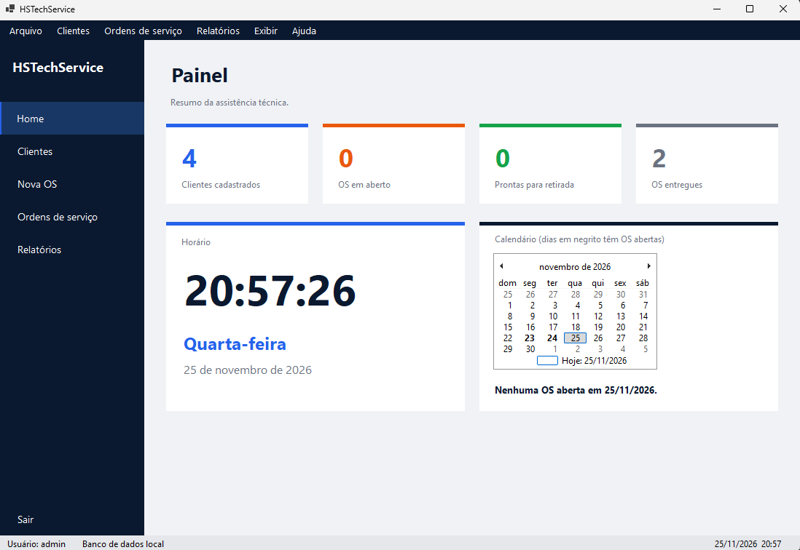
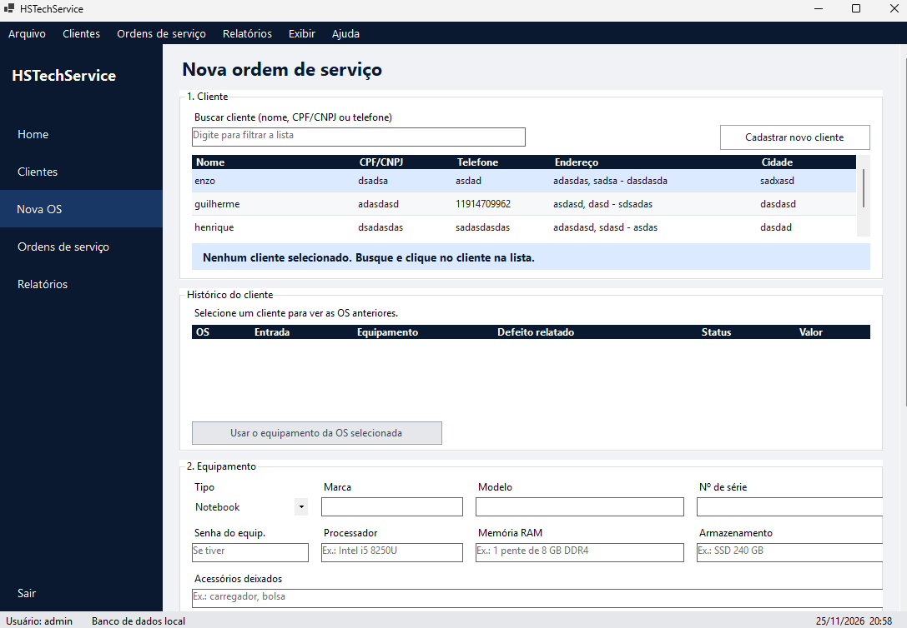
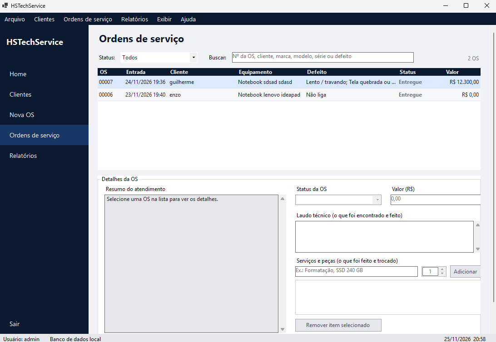
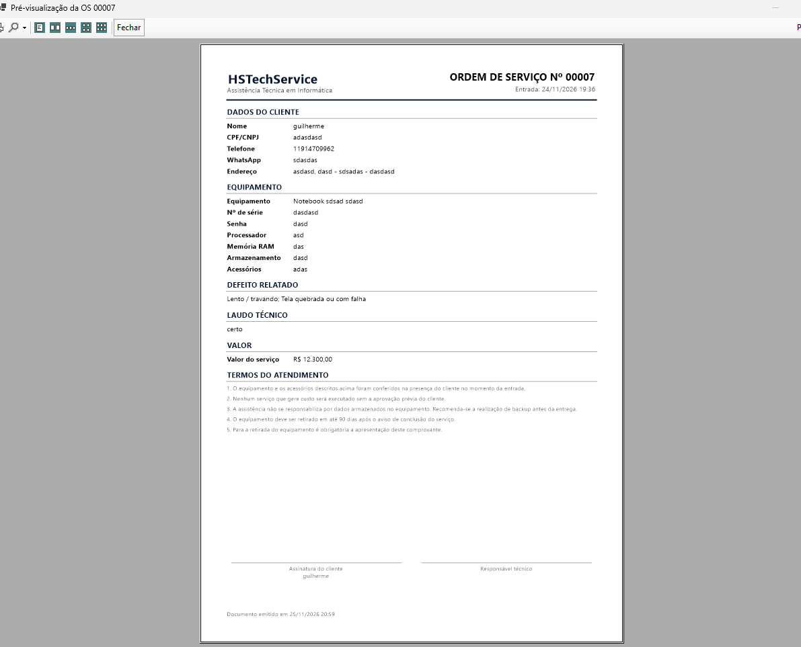
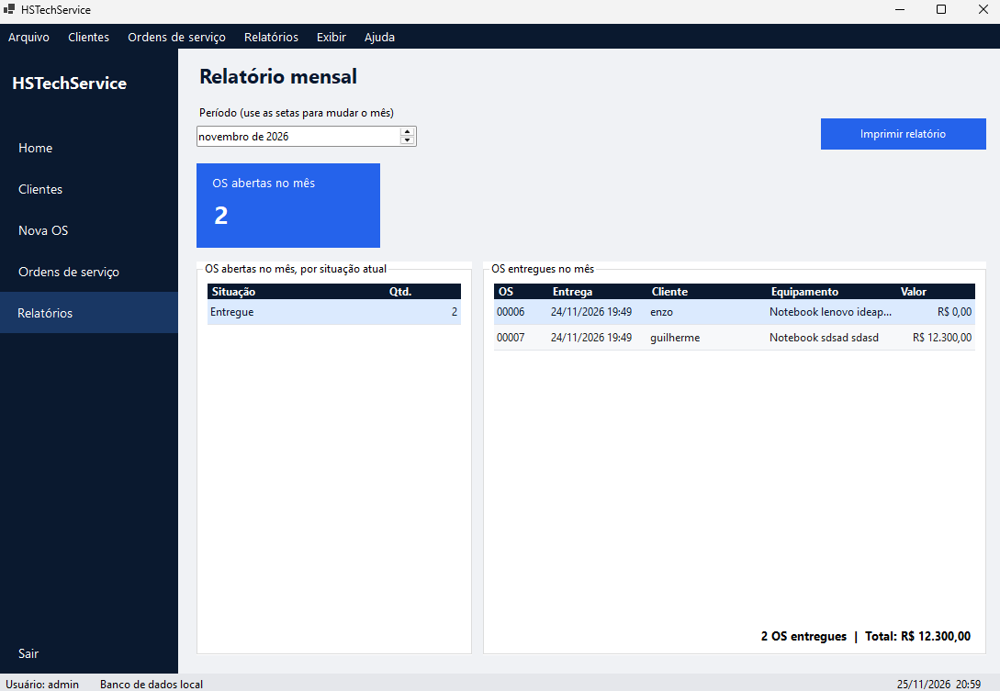

  

  Sistema de ordens de serviço para assistência técnica de informática, feito em C# com Windows Forms e SQLite.

---

## Sobre o projeto

O **HSTechService** é um sistema desktop para controlar o atendimento de uma assistência técnica de notebooks e desktops: do cadastro do cliente e do equipamento até a entrega, com impressão da OS para assinatura, aviso por WhatsApp e relatório mensal.

Foi desenvolvido por mim, a partir do dia a dia de uma assistência técnica, para praticar o desenvolvimento de um sistema completo: interface, banco de dados local, segurança de acesso, impressão e distribuição.

## Funcionalidades

**Atendimento**
- Cadastro de clientes (nome, CPF/CNPJ, telefone, WhatsApp, e-mail e endereço), com busca e exclusão com confirmação
- Nova OS: busca do cliente, dados do equipamento (marca, modelo, série, senha, processador, memória, armazenamento, acessórios) e checklist de defeitos
- Histórico de OS do cliente na abertura de uma nova OS, com opção de reaproveitar os dados do equipamento
- Lista de OS com busca e filtro por status (Aguardando, Em análise, Aguardando peça, Pronto, Entregue)
- Atualização de status, valor e laudo técnico, e registro de serviços e peças usados em cada OS
- Impressão da OS com a logo e os dados da loja, para o cliente assinar
- Aviso ao cliente por WhatsApp, com mensagem pronta de acordo com o status da OS

**Gestão**
- Painel inicial com indicadores, relógio e calendário com os dias que têm OS
- Relatório mensal: OS abertas e entregues, faturamento, situação das OS e lista de entregas, com impressão
- Tela de dados da loja (nome, contatos, endereço e logo)

**Segurança e dados**
- Senha criada pelo próprio usuário no primeiro acesso, guardada com hash PBKDF2 e salt
- Chave de recuperação de senha e bloqueio temporário após 5 tentativas erradas
- Banco SQLite local com versionamento e migração automática
- Backup manual, backup automático ao fechar o sistema e restauração de backup

## Tecnologias

- C# e .NET 10
- Windows Forms
- SQLite (Microsoft.Data.Sqlite)

## Capturas de tela

| Login | Painel inicial |
|---|---|
|  |  |

| Nova OS | Ordens de serviço |
|---|---|
|  |  |

| OS impressa | Relatório mensal |
|---|---|
|  |  |

## Como usar

**Pelo executável (Windows 10 ou 11, 64 bits)**
1. Baixe o arquivo `.zip` mais recente na página de [Releases](../../releases).
2. Extraia a pasta e abra o `HSTechService.exe`. Não é preciso instalar o .NET.
3. No primeiro acesso, crie a sua senha. Anote a chave de recuperação mostrada na tela.

Como o programa não tem assinatura digital, o Windows pode mostrar o aviso do SmartScreen. Clique em "Mais informações" e depois em "Executar assim mesmo".

**Pelo código-fonte**
1. Instale o Visual Studio com a carga de trabalho de desenvolvimento para desktop com .NET e o SDK do .NET 10.
2. Abra o arquivo `.slnx` e execute o projeto (F5).

Os dados ficam na pasta `%AppData%\HSTechService`, no próprio computador do usuário. Não existe usuário nem senha padrão: o login é `admin` e a senha é criada por você no primeiro acesso.

## Próximos passos

- Uso em várias máquinas com banco de dados compartilhado
- Controle de licença e de prazo de uso
- Controle de pagamento e estoque de peças

## Autor

**Henrique Santana**

- GitHub: [HenriqueeSantana](https://github.com/HenriqueeSantana)
- LinkedIn: _adicione o link do seu perfil_
- Portfólio: _adicione o link do seu site_

## Licença

Todos os direitos reservados. O código está público para fins de portfólio e avaliação. Não é permitido copiar, redistribuir ou usar comercialmente sem autorização do autor.
